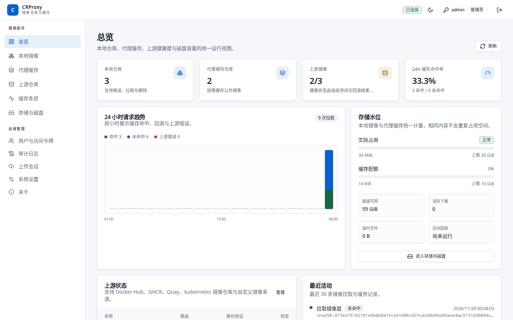
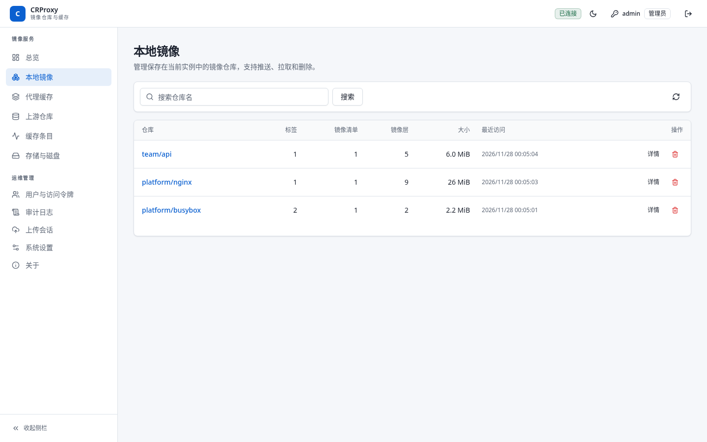
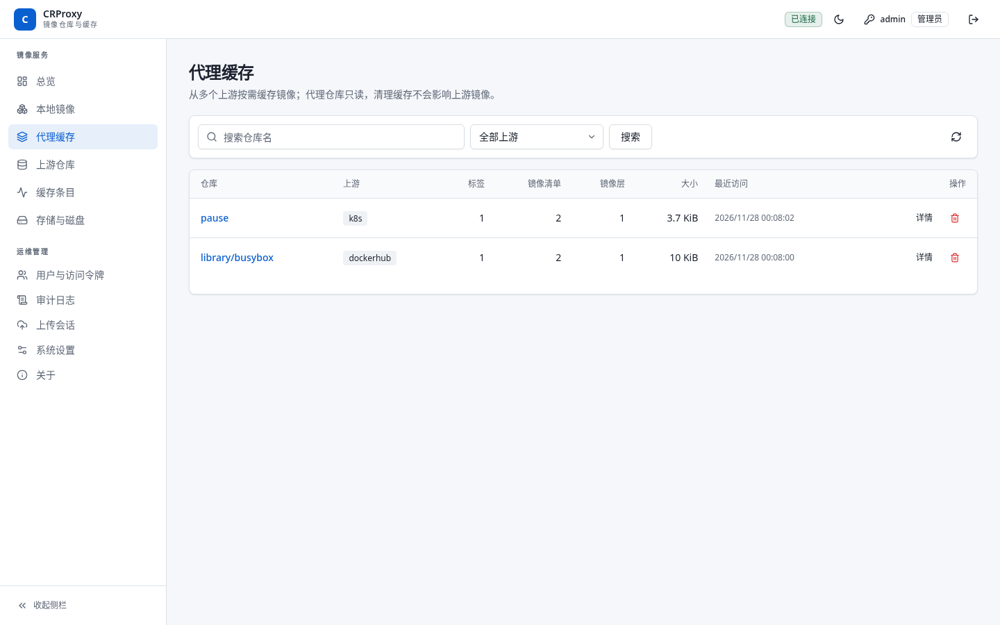
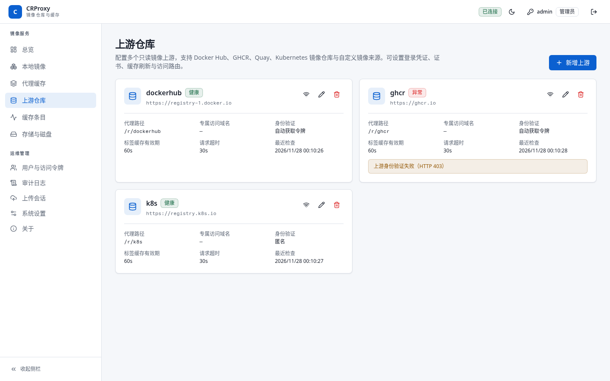

<div align="center">
  

  <h1>CRProxy</h1>

  <p><strong>A lightweight OCI registry with multi-upstream pull-through cache</strong></p>

  <p>One Go binary for private image storage, on-demand upstream caching, local accounts, storage lifecycle, and an embedded operations console.</p>

  <p><a href="#quick-start">Quick start</a> · <a href="#screenshots">Screenshots</a> · <a href="#features">Features</a> · <a href="#deployment-and-configuration">Deployment</a> · <a href="#kubernetes-containerd-mirror">containerd mirror</a> · <a href="#authentication-and-permissions">Authentication</a> · <a href="#local-development">Development</a> · <a href="docs/deployment.md">Runbook</a></p>

  <p><sub><strong>English</strong> · <a href="README.zh-CN.md">简体中文</a></sub></p>
</div>

## What is CRProxy?

CRProxy is a self-hosted OCI registry for teams that need both a private image store and a controlled cache for public images. It implements the OCI Distribution API locally and exposes Docker Hub, GHCR, Quay, `registry.k8s.io`, and other OCI-compatible upstreams through explicit proxy routes.

The product is deliberately smaller than Harbor. It runs as one Go process, stores metadata in SQLite, keeps content in a local block-storage directory, and embeds the management console into the binary. There is no external database, agent, OIDC provider, or LDAP dependency.

> **Project status:** pre-1.0. The registry protocol core is conformance-tested, but CRProxy is intentionally a single-node product with documented security and scale boundaries. Review [Security notes](#security-notes) and [Compatibility and boundaries](#compatibility-and-boundaries) before production use.

### Highlights

- **Registry first, cache second** — local push, pull, delete, tags, referrers, uploads, cross-repository mount, and content discovery are implemented as a normal OCI registry rather than an approximation around a cache.
- **Multiple upstreams by design** — Docker Hub, GHCR, Quay, `registry.k8s.io`, and arbitrary OCI Distribution endpoints can coexist with independent credentials, custom CA settings, TTLs, and route prefixes.
- **Cache without duplicating storage** — local and cached repositories share a content-addressed store, while cache eviction and GC never delete local image content.
- **Two planes, two authentication boundaries** — `/v2/*` uses registry credentials and token flow; `/api/v1/*` uses HttpOnly cookie sessions with CSRF protection. The two paths do not silently borrow each other's credentials.
- **Operationally complete** — quotas, watermarks, LRU cache eviction, GC/fsck, upload recovery, audit records, Prometheus metrics, TLS reload, and outbound HTTP/HTTPS proxy support are built in.
- **Single-binary deployment** — the React console is embedded with `go:embed`; the container image is distroless and runs as a non-root user. A hardened systemd unit is included.

## Screenshots

<p align="center">
  
</p>

| Local registry | Proxy cache |
|---|---|
|  |  |



> Screenshots are captured from an isolated demo instance. The management console is currently Chinese-first; the registry API and command-line interface are language-neutral.

## Features

| Area | Capabilities |
|---|---|
| Local OCI registry | OCI Distribution Spec 1.1 manifests, indexes, artifacts, blobs, chunked and streamed uploads, cross-repository mount, catalog, tags, referrers, delete, Range, and conditional requests |
| Pull-through cache | Read-only proxy pulls with manifest/tag TTL, ETag/304 revalidation, blob and token request coalescing, Range passthrough, and a shared CAS across repositories and upstreams |
| Upstream management | Path-based or Host-based routing, anonymous/Basic/Bearer/challenge authentication modes, private registry credentials, custom CA bundles, request timeouts, and per-upstream blob limits |
| Authentication | Registry Basic auth, Bearer PAT, Docker Registry token flow (HS256 JWT), configurable challenge mode, and optional anonymous actions; management sessions use HttpOnly cookies with CSRF protection |
| Access control | Global `admin`, `operator`, and `viewer` roles, PAT action scopes, account lifecycle, password changes, and audit records for authentication and write operations |
| Storage lifecycle | Logical quotas for local and cache data, high/low watermarks, LRU eviction, temp/trash cleanup, GC, fsck, and resumable upload sessions |
| Management console | Embedded React console for overview, repositories, cache entries, upstreams, storage, uploads, users, tokens, audit logs, and runtime settings |
| Networking and TLS | Shared or separate management listener, native TLS with atomic certificate reload, trusted reverse-proxy handling, HSTS, and outbound HTTP/HTTPS proxy support |
| Observability | Health/readiness endpoints, Prometheus metrics, request and cache activity, upstream health checks, and structured server logs |
| Operations | Offline backup/restore, master-key rotation, systemd integration, multi-architecture binaries, and multi-architecture container images |

## Design principles

### Distribution compatibility comes first

The local registry is the source of truth for repository semantics. CRProxy implements the OCI Distribution API directly, including push and content discovery rather than limiting itself to the read-only subset commonly found in image caches. The release baseline includes the official OCI Distribution Spec 1.1 conformance suite.

### The cache is a controlled read path

Proxy routes are strictly read-only. Write requests to a proxy route return `405` and are never forwarded upstream. Cached content is stored once in the shared CAS, while local content has an independent lifecycle and is not removed by cache LRU or cache cleanup.

### The management and registry planes stay separate

The OCI plane under `/v2/*` speaks Basic credentials, PAT, or Registry Token Flow. The management API under `/api/v1/*` accepts only its own cookie session and CSRF token. When a separate management listener is configured, the registry listener exposes only the Distribution API and probes, while the management listener serves the console and operational APIs.

### One process, explicit operations

One data directory is owned by one CRProxy process. SQLite uses the pure-Go driver with a rollback journal, not WAL. Backups are deliberately offline, and secrets such as `master.key`, `jwt.secret`, the database, and the CAS must be backed up together.

```text
Podman / containerd / CI
          │  OCI Distribution API
          ▼
┌─────────────────────────────────────┐
│ CRProxy                             │
│  registry plane      admin plane    │
│  ├─ local registry   ├─ console     │
│  ├─ proxy router     ├─ /api/v1     │
│  ├─ SQLite metadata  ├─ /metrics    │
│  └─ CAS/uploads      └─ probes      │
└─────────────────────────────────────┘
          │  optional outbound HTTP(S) proxy
          ▼
Docker Hub · GHCR · Quay · registry.k8s.io
```

## Quick start

### Prerequisites

- Go `1.24+`
- Node.js `24+` and npm for the embedded console
- Podman for the supported client smoke test
- Linux for the provided systemd unit, or a container runtime for the container image

### 1. Build and configure

```bash
git clone https://github.com/kube-dosh/crproxy.git
cd crproxy

cp crproxy.example.yaml crproxy.yaml
# Set auth.bootstrap_admin.password to at least 12 characters.
# Adjust storage.root and server.public_host/scheme for your environment.

make build
./bin/crproxy serve -config crproxy.yaml
```

The default shared listener is `:5000`. The initial data directory is `./data`, containing SQLite metadata under `data/meta`, the content-addressed store under `data/cas`, and upload/trash working directories.

### 2. Sign in

Open `http://127.0.0.1:5000/` and sign in with the configured bootstrap username and password. The bootstrap administrator must change the initial password before using the management API.

### 3. Pull through the cache

```bash
# Local HTTP development only.
podman login --tls-verify=false -u admin 127.0.0.1:5000

podman pull --tls-verify=false 127.0.0.1:5000/r/dockerhub/library/busybox:1.36
podman pull --tls-verify=false 127.0.0.1:5000/r/ghcr/actions/actions-runner:latest
podman pull --tls-verify=false 127.0.0.1:5000/r/quay/prometheus/busybox:latest
podman pull --tls-verify=false 127.0.0.1:5000/r/k8s/pause:3.10
```

The first pull resolves the upstream, stores the manifest and blobs, and returns the image to the client. Later pulls reuse the cache until the relevant manifest or tag policy requires revalidation.

### 4. Push a local image

```bash
podman tag 127.0.0.1:5000/r/dockerhub/library/busybox:1.36 \
  127.0.0.1:5000/team/busybox:1.36

podman push --tls-verify=false 127.0.0.1:5000/team/busybox:1.36
podman pull --tls-verify=false 127.0.0.1:5000/team/busybox:1.36
```

Do not use `--tls-verify=false` in production. Put CRProxy behind a trusted TLS terminator or configure native TLS with `server.tls.mode: file`.

## Build the container image

```bash
podman build -t crproxy:local .

podman volume create crproxy-data
podman run -d --name crproxy \
  -p 5000:5000 \
  -e CRPROXY_ADMIN_PASSWORD='replace-with-a-long-password' \
  -e CRPROXY_PUBLIC_HOST='localhost:5000' \
  -e CRPROXY_PUBLIC_SCHEME='http' \
  -v crproxy-data:/var/lib/crproxy \
  --read-only --tmpfs /tmp:size=64m,mode=1777 \
  --cap-drop=ALL --security-opt no-new-privileges \
  crproxy:local
```

GitHub Actions is configured to publish multi-architecture images to `ghcr.io/kube-dosh/crproxy`. The `nightly` channel tracks `main`; semver release tags are produced from `v*` tags. Pin a digest in production.

## Deployment and configuration

For the complete production checklist, see [Deployment and operations](docs/deployment.md). The primary deployment shapes are a hardened systemd service, a read-only container, and a shared or split management/registry listener.

### Configuration overview

`crproxy.example.yaml` is the canonical configuration reference. YAML is the startup baseline; selected settings can also be changed from the console and are persisted in SQLite until reset.

| Setting | Purpose |
|---|---|
| `server.listen` | Registry and, by default, management listener address |
| `server.public_host` / `server.public_scheme` | Client-facing registry origin used for Bearer realms, cookies, and generated URLs |
| `server.admin.listen` | Optional separate management listener; omit or leave empty to share the registry listener |
| `server.trusted_proxies` | CIDR/IP ranges allowed to provide forwarding headers |
| `server.tls.mode` / `server.admin.tls.mode` | Registry TLS mode, and optional management TLS mode (`inherit`, `file`, or `none`) |
| `storage.root` | Root for `meta/`, `cas/`, `uploads/`, `tmp/`, and `trash/`; all must share one filesystem |
| `storage.max_bytes` / `storage.cache_max_bytes` | Overall logical quota and proxy-cache quota |
| `proxy.path_prefix` | Path prefix for proxy routes, default `r` |
| `auth.registry.challenge` | Advertise `bearer` or `basic` on registry authentication challenges |
| `auth.registry.allow_anonymous` / `anonymous_actions` | Enable only the anonymous actions required by the environment |
| `upstreams_seed` | Seed upstream definitions; console changes are not overwritten |
| `outbound_proxy` | HTTP/HTTPS proxy used for upstream registry requests |

Runtime sections exposed in the console, including storage thresholds, upload TTL, audit retention, proxy routing, HSTS, and outbound proxy settings, take effect without restarting. Listener addresses, public URL/scheme, trusted proxies, TLS mode and certificate paths, storage root, bootstrap administrator, and key file paths require a restart.

### Outbound HTTP/HTTPS proxy

```yaml
outbound_proxy:
  http_proxy: http://proxy.example.com:3128
  https_proxy: http://proxy.example.com:3128
  no_proxy: localhost,127.0.0.1,::1,.internal.example.com
  username: ""
  password: ""
```

HTTPS upstreams use an HTTP `CONNECT` tunnel. If CRProxy runs in a VM or container and the proxy runs on the host, `127.0.0.1` refers to the CRProxy process itself; use an address reachable from its network namespace. Container deployments may also use the standard `HTTP_PROXY`, `HTTPS_PROXY`, and `NO_PROXY` environment variables, but the YAML block remains the canonical configuration.

### Separate management listener

```yaml
server:
  listen: "0.0.0.0:5000"
  public_host: "registry.example.com:5000"
  public_scheme: "https"
  admin:
    listen: "0.0.0.0:5443"
    public_host: "admin.example.com:5443"
    public_scheme: "https"
    tls:
      mode: inherit
```

With a separate listener, the registry port serves `/v2/`, `/v2/token`, `/healthz`, and `/readyz`; the management port serves the console, `/api/v1/*`, `/metrics`, and probes. If `server.admin.listen` is omitted, empty, or equal to `server.listen`, both planes share one listener without rebinding.

### Kubernetes containerd mirror

CRProxy can act as a pull-through cache for Docker Hub, GHCR, Quay, and `registry.k8s.io`. Containerd selects registry mirrors through per-registry `hosts.toml` files; the examples below use `/etc/containerd/certs.d` as the configuration directory.

**1. Create a read-only pull identity.**

Create a local account with the `viewer` role from the management console, or create a PAT that only allows pull operations. Do not distribute an administrator password to cluster nodes. If the network is isolated and anonymous pulls are acceptable, enable `auth.registry.allow_anonymous` and set `anonymous_actions: [pull]` instead of sending an Authorization header.

Generate the Basic header value for a username and password/PAT:

```bash
printf '%s' 'registry-reader:CHANGE_ME' | base64 -w0
# Header value: Basic <output-of-command>
```

Use HTTPS whenever the `hosts.toml` file contains credentials. Plain HTTP is appropriate only on an isolated test network.

**2. Enable the containerd hosts directory.**

For containerd 2.x, set `config_path` in `/etc/containerd/config.toml`:

```toml
version = 3

[plugins."io.containerd.cri.v1.images".registry]
  config_path = "/etc/containerd/certs.d"
```

For containerd 1.x:

```toml
version = 2

[plugins."io.containerd.grpc.v1.cri".registry]
  config_path = "/etc/containerd/certs.d"
```

If `config_path` already contains `/etc/containerd/certs.d`, no change is required. Restart containerd after changing `config.toml`.

**3. Configure the Docker Hub mirror.**

```bash
sudo install -d -m 0755 /etc/containerd/certs.d/docker.io
sudoedit /etc/containerd/certs.d/docker.io/hosts.toml
sudo chmod 0600 /etc/containerd/certs.d/docker.io/hosts.toml
```

```toml
# /etc/containerd/certs.d/docker.io/hosts.toml
server = "https://crproxy.example.com/v2/r/dockerhub"
capabilities = ["pull", "resolve"]
override_path = true

# Uncomment only when CRProxy uses a private CA.
# ca = "/etc/containerd/certs.d/crproxy.example.com/ca.crt"

# Omit this table when anonymous pull is enabled.
[header]
  Authorization = "Basic <base64(registry-reader:password)>"
```

The `/v2/r/dockerhub` path is the proxy API root for the seeded `dockerhub` upstream. `override_path = true` prevents containerd from appending another `/v2` and therefore preserves the `/v2/r/dockerhub` prefix. The configuration above uses CRProxy only; if CRProxy is unavailable, pulls fail instead of falling back to Docker Hub.

Containerd automatically appends an `ns=docker.io` query parameter when a mirror host differs from the original registry namespace. CRProxy accepts this parameter transparently; no additional route or proxy setting is required.

To keep Docker Hub as a direct fallback, use containerd's `host` table instead:

```toml
server = "https://registry-1.docker.io"

[host."https://crproxy.example.com/v2/r/dockerhub"]
  capabilities = ["pull", "resolve"]
  override_path = true
  [host."https://crproxy.example.com/v2/r/dockerhub".header]
    Authorization = "Basic <base64(registry-reader:password)>"
```

**4. Add other upstreams.**

Create one directory per client-facing registry namespace. Repeat the same file format and change only the CRProxy endpoint:

| Image source | `hosts.toml` directory | CRProxy endpoint |
|---|---|---|
| Docker Hub | `/etc/containerd/certs.d/docker.io/` | `https://crproxy.example.com/v2/r/dockerhub` |
| GHCR | `/etc/containerd/certs.d/ghcr.io/` | `https://crproxy.example.com/v2/r/ghcr` |
| Quay | `/etc/containerd/certs.d/quay.io/` | `https://crproxy.example.com/v2/r/quay` |
| Kubernetes registry | `/etc/containerd/certs.d/registry.k8s.io/` | `https://crproxy.example.com/v2/r/k8s` |

For `registry.k8s.io`, for example:

```toml
# /etc/containerd/certs.d/registry.k8s.io/hosts.toml
server = "https://crproxy.example.com/v2/r/k8s"
capabilities = ["pull", "resolve"]
override_path = true

[header]
  Authorization = "Basic <base64(registry-reader:password)>"
```

Keep every `hosts.toml` at mode `0600` when it contains credentials. Files under `certs.d` are reloaded without restarting containerd; changes to `config_path` itself require a restart.

**5. Verify pulls and cache hits.**

```bash
sudo crictl pull docker.io/library/busybox:1.36
sudo crictl pull registry.k8s.io/pause:3.10

# Remove the local image, then pull again to exercise the CRProxy cache.
sudo crictl rmi docker.io/library/busybox:1.36
sudo crictl pull docker.io/library/busybox:1.36
```

The first pull goes upstream and populates CRProxy. The second pull should use the cached manifest and blobs; confirm the repository appears under **Proxy cache** in the console. For request-level debugging, bypass CRI with:

```bash
sudo ctr -n k8s.io images pull \
  --hosts-dir /etc/containerd/certs.d \
  docker.io/library/busybox:1.36
```

See the [deployment runbook](docs/deployment.md) for CA placement, private upstream credentials, and the full production checklist.

## Authentication and permissions

| Plane | Credentials | Notes |
|---|---|---|
| Registry `/v2/*` | Basic username/password, PAT as Basic password or Bearer token, Docker Registry Token Flow | `auth.registry.challenge` controls the advertised flow, not the accepted credential set. Proxy routes remain read-only. |
| Management `/api/v1/*` | HttpOnly session cookie plus CSRF token | The API rejects registry Basic/Bearer credentials and never returns a registry authentication challenge. |
| Roles | `admin`, `operator`, `viewer`, and PAT action scopes | The effective PAT permission is the intersection of the user's role and the token scope. |
| Optional anonymous access | `pull`, `push`, `delete`, or `catalog` actions | Disabled by default. Enable only on controlled networks and only for the actions that are explicitly required. |

CRProxy does not integrate OIDC, LDAP, or SAML. Accounts are local. Repository-level ACLs are not implemented; use separate instances or network isolation when teams do not share a trust boundary.

## Quality and compatibility

- OCI Distribution Spec `1.1`: `850 passed / 4 optional skips / 0 failed / 0 error`.
- Go unit and integration tests, race detector, and `go vet` pass.
- The documented image-client acceptance path uses Podman 5.8.9. Other clients may work but are not part of the current acceptance baseline.
- The reference deployment covers local push/pull, PAT pull, multi-upstream proxy pulls, cache hits, TLS certificate reload, outbound HTTP proxy, and a read-only container runtime.
- Builds are tested for Linux `amd64` and `arm64`.

See [OCI conformance report](docs/conformance-report.md), [acceptance baseline](docs/acceptance-baseline.md), and [Podman smoke test](docs/podman-smoke.md).

## Security notes

- Terminate TLS before exposing the service to an untrusted network. Set `server.public_scheme: https` and `server.public_host` to the real client-facing address.
- Change the bootstrap administrator password immediately. On suspected compromise, change the password and revoke API tokens; these are separate operations.
- Treat `/api/v1` and `/metrics` as trusted-network endpoints. Protect them with a reverse proxy, network policy, or an additional authentication layer when required.
- Configure `trusted_proxies` only for reverse proxies you control, and ensure the edge proxy overwrites client-supplied forwarding headers.
- Protect `master.key`, `jwt.secret`, `crproxy.db`, and the CAS together. Losing the master key makes stored upstream credentials unrecoverable.
- Run exactly one CRProxy process per data directory. The process acquires a data-directory lock and does not support shared storage between instances.
- Backups are offline only. Stop the service before `crproxy backup` or `crproxy restore`, and test restore procedures in a clean environment.

Report vulnerabilities through the process in [SECURITY.md](SECURITY.md). Do not disclose security details in a public issue before a fix is available.

## Compatibility and boundaries

- Single instance with local block storage. Object storage, multi-instance shared storage, distributed locking, and cross-region replication are not supported.
- No OIDC, LDAP, or SAML integration; accounts are local.
- No Docker schema1 support.
- No repository-level ACL or project/tenant model.
- No vulnerability scanning, signature verification policy, image replication, or admission policy.
- Proxy routes are strictly read-only. Write requests to proxy routes return `405` and are never forwarded upstream.
- Offline backup only; no online snapshot or point-in-time recovery.
- No built-in high availability, automated failover, or commercial support SLA.
- SQLite uses a rollback journal, not WAL.

CRProxy is not a drop-in Harbor replacement. It is designed for teams that value a small operational footprint, a complete OCI registry path, and a controlled multi-upstream cache over multi-tenant platform features.

## Local development

```bash
make build
./bin/crproxy serve -config crproxy.yaml
```

For frontend development, run the backend on `127.0.0.1:5000` and Vite in another terminal:

```bash
cd web
npm run dev
```

Open `http://127.0.0.1:5173`. Vite proxies `/api` and `/v2` to the Go process.

Common quality checks:

```bash
make verify
```

`make verify` runs Go tests, race tests, `go vet`, frontend type checking, frontend tests, and the production frontend build. Client acceptance tests use Podman only.

## Project structure

```text
cmd/crproxy/             CLI entry point
internal/adminapi/       management API and session boundaries
internal/auth/           passwords, sessions, PAT, and registry tokens
internal/proxy/          upstream routing, manifest/blob proxying, and cache events
internal/registry/       OCI Distribution API implementation
internal/cas/            content-addressed storage
internal/storage/        quotas, eviction, GC, fsck, and upload lifecycle
internal/store/          SQLite metadata and audit records
internal/upstreammgr/    upstream lifecycle, credentials, and health checks
internal/runtimeconfig/  hot-updatable runtime settings
web/                     React + TypeScript + Tailwind management console
deploy/                  systemd and container deployment assets
docs/                    design, deployment, conformance, and acceptance documents
```

## Documentation

- [Deployment and operations](docs/deployment.md)
- [Overall design](DESIGN.md)
- [Registry protocol design](docs/registry-protocol-design.md)
- [Authentication and TLS design](docs/auth-design.md)
- [Storage and cache design](docs/storage-design.md)
- [Frontend design](docs/frontend-design.md)
- [Release acceptance baseline](docs/acceptance-baseline.md)
- [OCI conformance report](docs/conformance-report.md)
- [Podman smoke test](docs/podman-smoke.md)
- [Commercial release checklist](docs/release-checklist.md)
- [OpenAPI document](docs/openapi.yaml)

Detailed design documents are currently maintained in Chinese. The English and Chinese READMEs are equivalent project entry points; the English README is authoritative for build and licensing information if they diverge.

## Contributing

Contributions are welcome under the Apache License 2.0. Read [CONTRIBUTING.md](CONTRIBUTING.md) before opening a pull request. All commits must include a Developer Certificate of Origin sign-off.

---

If you need a small registry that can store private images, accelerate public pulls, and stay understandable to operate, CRProxy is built for that job.

## License

Copyright 2026 The CRProxy Authors.

Apache License 2.0. See [LICENSE](LICENSE) and [NOTICE](NOTICE).
