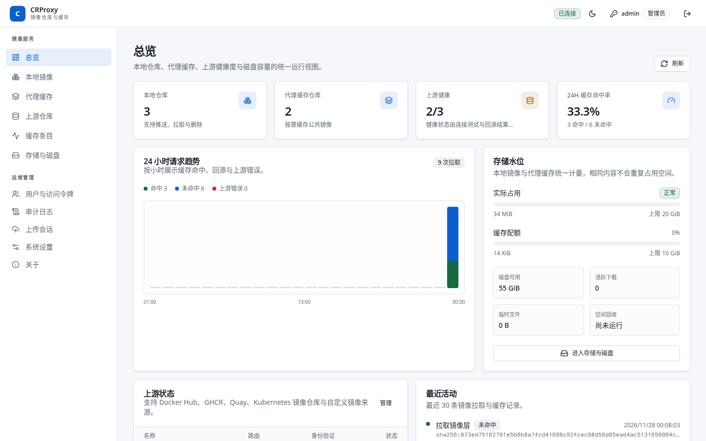
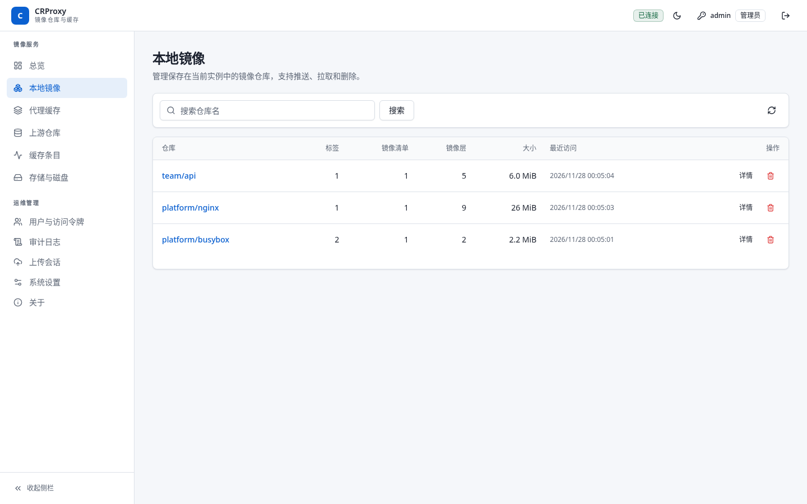
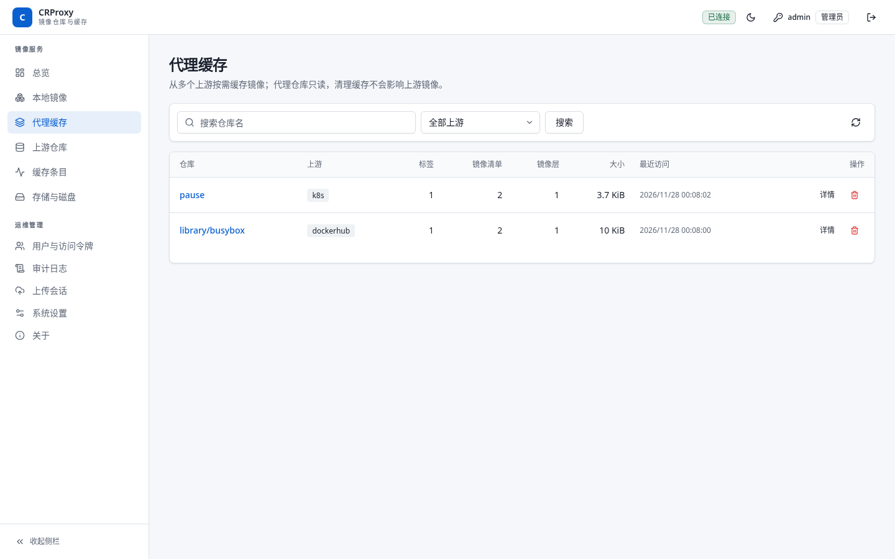
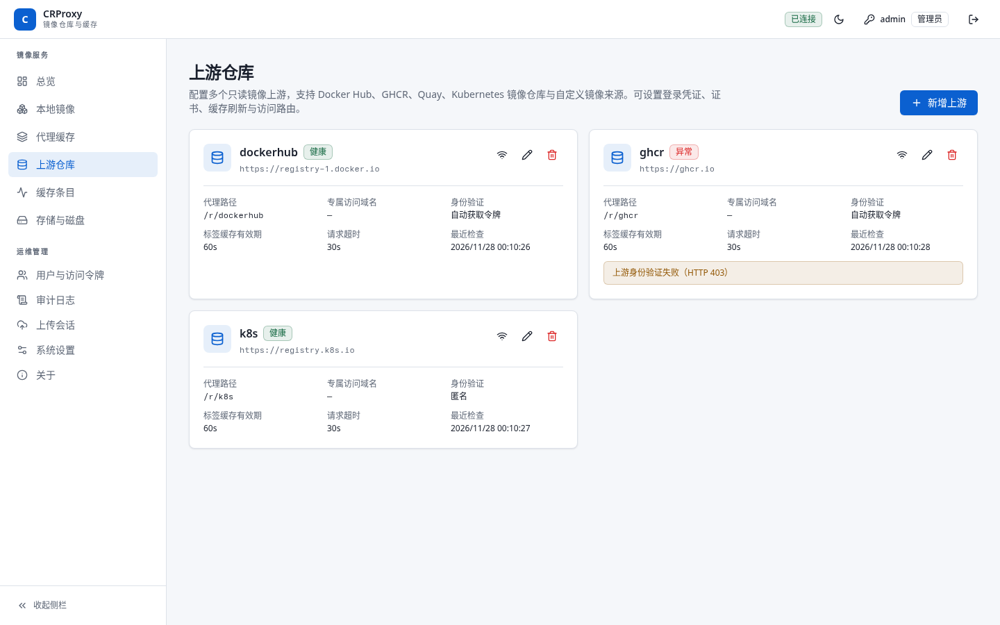

<div align="center">
  

  <h1>CRProxy</h1>

  <p><strong>轻量级 OCI 镜像仓库与多上游 Pull-Through Cache</strong></p>

  <p>单个 Go 二进制，统一提供私有镜像存储、按需上游缓存、本地账号、存储生命周期和内嵌运维控制台。</p>

  <p><a href="#快速开始">快速开始</a> · <a href="#产品截图">产品截图</a> · <a href="#功能一览">功能一览</a> · <a href="#部署与配置">部署</a> · <a href="#kubernetes-containerd-镜像加速">containerd 镜像加速</a> · <a href="#认证与权限">认证</a> · <a href="#本地开发">开发</a> · <a href="docs/deployment.md">运维手册</a></p>

  <p><sub><a href="README.md">English</a> · <strong>简体中文</strong></sub></p>
</div>

## CRProxy 是什么？

CRProxy 是一个自托管 OCI 镜像仓库，面向同时需要私有镜像存储和公共镜像加速的团队。它在本地完整实现 OCI Distribution API，并通过明确的代理路由接入 Docker Hub、GHCR、Quay、`registry.k8s.io` 及其他兼容 OCI Distribution 的上游。

CRProxy 刻意保持比 Harbor 更小的产品边界：单个 Go 进程、SQLite 元数据、本地块存储、内嵌 React 管理台。不依赖外部数据库、集群内 Agent、OIDC 或 LDAP。

> **项目状态：** 尚未发布 1.0。Registry 协议核心已通过一致性测试，但 CRProxy 明确是单实例产品，并存在有边界的安全与规模限制。生产使用前请阅读[安全注意事项](#安全注意事项)和[兼容性与边界](#兼容性与边界)。

### 核心特点

- **Registry 优先，缓存其次** —— 本地 push、pull、delete、tags、referrers、上传、跨仓库 mount 和内容发现都是标准 OCI Registry 能力，不是围绕缓存拼出的近似实现。
- **原生支持多上游** —— Docker Hub、GHCR、Quay、`registry.k8s.io` 和任意 OCI Distribution 端点可以同时存在，并分别配置凭证、自定义 CA、TTL 和路由前缀。
- **缓存不重复占用空间** —— 本地仓库和代理缓存共享内容寻址存储，但缓存淘汰与 GC 永远不会删除本地镜像内容。
- **双平面、双认证边界** —— `/v2/*` 使用 Registry 凭证与 Token Flow；`/api/v1/*` 使用 HttpOnly Cookie Session 和 CSRF。两条路径不会串用认证方式。
- **运维能力完整** —— 配额、水位、缓存 LRU、GC/fsck、上传恢复、审计、Prometheus 指标、TLS 热加载和出站 HTTP/HTTPS 代理均为内置能力。
- **单二进制交付** —— React 管理台通过 `go:embed` 嵌入二进制；容器镜像基于 distroless 并以非 root 用户运行，同时提供加固后的 systemd unit。

## 产品截图

<p align="center">
  
</p>

| 本地镜像 | 代理缓存 |
|---|---|
|  |  |



> 截图来自隔离的演示实例。当前管理台以中文为主；Registry API 和命令行接口与语言无关。

## 功能一览

| 领域 | 能力 |
|---|---|
| 本地 OCI Registry | OCI Distribution Spec 1.1 manifest、index、artifact、blob、普通/分块/流式上传、跨仓库 mount、catalog、tags、referrers、delete、Range 和条件请求 |
| Pull-Through Cache | 只读代理拉取、manifest/tag TTL、ETag/304 回源、blob/token 请求合并、Range 透传，以及跨仓库、跨上游共享的 CAS |
| 上游管理 | 路径路由或 Host 路由、匿名/Basic/Bearer/challenge 认证、私有仓库凭证、自定义 CA、请求超时和单上游 Blob 上限 |
| 认证 | Registry Basic、Bearer PAT、Docker Registry Token Flow（HS256 JWT）、可配置 challenge 形式和可选匿名 action；管理台使用 HttpOnly Cookie 与 CSRF 防护 |
| 权限控制 | 全局 `admin`、`operator`、`viewer` 角色，PAT action scope，账号生命周期、改密，以及认证和写操作审计 |
| 存储生命周期 | 本地与缓存逻辑配额、高低水位、LRU 淘汰、临时/回收站清理、GC、fsck 和可恢复上传会话 |
| 管理台 | 内嵌 React 控制台，覆盖总览、本地镜像、缓存条目、上游、存储、上传、用户、Token、审计和运行时设置 |
| 网络与 TLS | 管理面与 Registry 面共用或独立监听、原生 TLS 原子热加载、可信反向代理、HSTS，以及出站 HTTP/HTTPS 代理 |
| 可观测性 | 健康/就绪探测、Prometheus 指标、请求与缓存活动、上游健康检查和结构化服务日志 |
| 运维 | 离线备份恢复、主密钥轮换、systemd 集成、多架构二进制和多架构容器镜像 |

## 设计原则

### 先保证 Distribution 兼容性

本地 Registry 是仓库语义的唯一事实来源。CRProxy 直接实现 OCI Distribution API，包括 push 和内容发现，而不是只实现镜像缓存常见的只读子集。发布基线包含官方 OCI Distribution Spec 1.1 一致性测试。

### 缓存是一条受控的只读路径

代理路由严格只读。向代理路由发送写请求会返回 `405`，绝不转发到上游。缓存内容在共享 CAS 中只存一份，同时本地内容拥有独立生命周期，不会被缓存 LRU 或缓存清理删除。

### 管理面与 Registry 面严格分离

`/v2/*` 使用 Basic 凭证、PAT 或 Registry Token Flow；`/api/v1/*` 只接受自己的 Cookie Session 和 CSRF Token。配置独立管理监听后，Registry 端口只暴露 Distribution API 和探测端点，管理端口负责控制台与运维 API。

### 单进程、显式运维

一个数据目录只由一个 CRProxy 进程持有。SQLite 使用纯 Go 驱动和 rollback journal，不启用 WAL。备份采用离线模式，`master.key`、`jwt.secret`、数据库和 CAS 必须一起备份。

```text
Podman / containerd / CI
          │  OCI Distribution API
          ▼
┌─────────────────────────────────────┐
│ CRProxy                             │
│  Registry 面          管理面         │
│  ├─ 本地仓库          ├─ 控制台       │
│  ├─ 代理路由          ├─ /api/v1     │
│  ├─ SQLite 元数据     ├─ /metrics    │
│  └─ CAS/上传           └─ 探测端点     │
└─────────────────────────────────────┘
          │  可选出站 HTTP(S) 代理
          ▼
Docker Hub · GHCR · Quay · registry.k8s.io
```

## 快速开始

### 前置条件

- Go `1.24+`
- Node.js `24+` 和 npm，用于构建内嵌管理台
- 客户端冒烟测试使用 Podman
- systemd 部署需要 Linux；容器部署需要容器运行时

### 1. 构建与配置

```bash
git clone https://github.com/kube-dosh/crproxy.git
cd crproxy

cp crproxy.example.yaml crproxy.yaml
# 将 auth.bootstrap_admin.password 设置为至少 12 个字符。
# 按实际环境调整 storage.root 和 server.public_host/scheme。

make build
./bin/crproxy serve -config crproxy.yaml
```

默认共用监听地址为 `:5000`。初始数据目录为 `./data`，其中 `data/meta` 保存 SQLite 元数据，`data/cas` 保存内容寻址数据，另有上传和回收站工作目录。

### 2. 登录控制台

打开 `http://127.0.0.1:5000/`，使用配置中的 bootstrap 管理员账号和密码登录。首次登录必须先修改初始密码，之后才能使用管理 API。

### 3. 通过缓存拉取镜像

```bash
# 仅限本地 HTTP 开发环境。
podman login --tls-verify=false -u admin 127.0.0.1:5000

podman pull --tls-verify=false 127.0.0.1:5000/r/dockerhub/library/busybox:1.36
podman pull --tls-verify=false 127.0.0.1:5000/r/ghcr/actions/actions-runner:latest
podman pull --tls-verify=false 127.0.0.1:5000/r/quay/prometheus/busybox:latest
podman pull --tls-verify=false 127.0.0.1:5000/r/k8s/pause:3.10
```

首次拉取会解析上游、写入 manifest 和 Blob，并把镜像返回给客户端。后续拉取在 manifest 或 tag 策略要求回源前直接使用缓存。

### 4. 推送本地镜像

```bash
podman tag 127.0.0.1:5000/r/dockerhub/library/busybox:1.36 \
  127.0.0.1:5000/team/busybox:1.36

podman push --tls-verify=false 127.0.0.1:5000/team/busybox:1.36
podman pull --tls-verify=false 127.0.0.1:5000/team/busybox:1.36
```

生产环境禁止使用 `--tls-verify=false`。应在 CRProxy 前使用可信 TLS 终止器，或通过 `server.tls.mode: file` 配置原生 TLS。

## 构建容器镜像

```bash
podman build -t crproxy:local .

podman volume create crproxy-data
podman run -d --name crproxy \
  -p 5000:5000 \
  -e CRPROXY_ADMIN_PASSWORD='replace-with-a-long-password' \
  -e CRPROXY_PUBLIC_HOST='localhost:5000' \
  -e CRPROXY_PUBLIC_SCHEME='http' \
  -v crproxy-data:/var/lib/crproxy \
  --read-only --tmpfs /tmp:size=64m,mode=1777 \
  --cap-drop=ALL --security-opt no-new-privileges \
  crproxy:local
```

GitHub Actions 已配置为把多架构镜像发布到 `ghcr.io/kube-dosh/crproxy`。`nightly` 跟踪 `main`，`v*` 标签生成 semver 发布版本。生产环境应固定 digest。

## 部署与配置

完整生产部署清单见[部署与运维](docs/deployment.md)。主要部署形态包括加固 systemd 服务、只读容器，以及共用或分离的管理/Registry 监听。

### 配置概览

`crproxy.example.yaml` 是完整配置参考。YAML 构成启动基线；部分设置也可在管理台修改，并持久化到 SQLite，直到在页面中恢复默认值。

| 配置项 | 用途 |
|---|---|
| `server.listen` | Registry 监听地址；默认同时承载管理面 |
| `server.public_host` / `server.public_scheme` | 客户端可见的 Registry 地址，用于 Bearer realm、Cookie 和生成 URL |
| `server.admin.listen` | 可选独立管理监听；省略或留空时共用 Registry 监听 |
| `server.trusted_proxies` | 允许提供转发头的 CIDR/IP 范围 |
| `server.tls.mode` / `server.admin.tls.mode` | Registry TLS 模式，以及可选管理面 TLS 模式（`inherit`、`file` 或 `none`） |
| `storage.root` | `meta/`、`cas/`、`uploads/`、`tmp/`、`trash/` 根目录，必须位于同一文件系统 |
| `storage.max_bytes` / `storage.cache_max_bytes` | 总体逻辑配额和代理缓存配额 |
| `proxy.path_prefix` | 代理路由前缀，默认 `r` |
| `auth.registry.challenge` | Registry 认证挑战使用 `bearer` 或 `basic` |
| `auth.registry.allow_anonymous` / `anonymous_actions` | 仅开启环境明确需要的匿名 action |
| `upstreams_seed` | 初始化上游定义；管理台修改不会被 seed 覆盖 |
| `outbound_proxy` | 上游 Registry 请求使用的 HTTP/HTTPS 代理 |

管理台暴露的运行时分区，包括存储阈值、上传 TTL、审计保留期、代理入口、HSTS 和出站代理，保存后无需重启即可生效。监听地址、公网地址与协议、可信代理、TLS 模式与证书路径、存储根目录、bootstrap 管理员和密钥路径需要重启。

### 出站 HTTP/HTTPS 代理

```yaml
outbound_proxy:
  http_proxy: http://proxy.example.com:3128
  https_proxy: http://proxy.example.com:3128
  no_proxy: localhost,127.0.0.1,::1,.internal.example.com
  username: ""
  password: ""
```

HTTPS 上游通过 HTTP `CONNECT` 隧道访问。若 CRProxy 运行在虚拟机或容器内、代理运行在宿主机，`127.0.0.1` 指向的是 CRProxy 自身；必须填写其网络命名空间可访问的宿主地址。容器部署也可使用标准 `HTTP_PROXY`、`HTTPS_PROXY` 和 `NO_PROXY` 环境变量，但 YAML 仍然是规范配置源。

### 独立管理监听

```yaml
server:
  listen: "0.0.0.0:5000"
  public_host: "registry.example.com:5000"
  public_scheme: "https"
  admin:
    listen: "0.0.0.0:5443"
    public_host: "admin.example.com:5443"
    public_scheme: "https"
    tls:
      mode: inherit
```

拆分后，Registry 端口提供 `/v2/`、`/v2/token`、`/healthz` 和 `/readyz`；管理端口提供控制台、`/api/v1/*`、`/metrics` 和探测端点。若 `server.admin.listen` 省略、为空或与 `server.listen` 相同，两个平面自动共用同一监听，不会重复绑定。

### Kubernetes containerd 镜像加速

CRProxy 可以作为 Docker Hub、GHCR、Quay 和 `registry.k8s.io` 的 Pull-Through Cache。containerd 通过每个 Registry 命名空间对应的 `hosts.toml` 选择镜像源；以下示例统一使用 `/etc/containerd/certs.d` 作为配置目录。

**1. 创建只读拉取身份。**

在管理台“用户与访问令牌”页面创建 `viewer` 角色的本地账号，或创建一个仅允许 pull 的 PAT。不要把管理员密码分发到集群节点。如果网络隔离且允许匿名拉取，可开启 `auth.registry.allow_anonymous` 并设置 `anonymous_actions: [pull]`，然后在 `hosts.toml` 中省略 Authorization。

生成用户名与密码/PAT 的 Basic Header：

```bash
printf '%s' 'registry-reader:CHANGE_ME' | base64 -w0
# Header 值：Basic <命令输出>
```

`hosts.toml` 中包含凭证时必须使用 HTTPS；纯 HTTP 只适用于隔离的测试网络。

**2. 启用 containerd hosts 配置目录。**

containerd 2.x 在 `/etc/containerd/config.toml` 中配置：

```toml
version = 3

[plugins."io.containerd.cri.v1.images".registry]
  config_path = "/etc/containerd/certs.d"
```

containerd 1.x 使用：

```toml
version = 2

[plugins."io.containerd.grpc.v1.cri".registry]
  config_path = "/etc/containerd/certs.d"
```

若 `config_path` 已包含 `/etc/containerd/certs.d`，无需修改。修改 `config.toml` 后需要重启 containerd。

**3. 配置 Docker Hub 镜像缓存。**

```bash
sudo install -d -m 0755 /etc/containerd/certs.d/docker.io
sudoedit /etc/containerd/certs.d/docker.io/hosts.toml
sudo chmod 0600 /etc/containerd/certs.d/docker.io/hosts.toml
```

```toml
# /etc/containerd/certs.d/docker.io/hosts.toml
server = "https://crproxy.example.com/v2/r/dockerhub"
capabilities = ["pull", "resolve"]
override_path = true

# 仅当 CRProxy 使用私有 CA 时取消注释。
# ca = "/etc/containerd/certs.d/crproxy.example.com/ca.crt"

# 已启用匿名拉取时删除此表。
[header]
  Authorization = "Basic <base64(registry-reader:password)>"
```

`/v2/r/dockerhub` 是内置 `dockerhub` 上游的代理 API 根路径。`override_path = true` 会阻止 containerd 再追加一级 `/v2`，从而完整保留 `/v2/r/dockerhub` 前缀。以上配置只使用 CRProxy；CRProxy 不可用时拉取会失败，不会直连 Docker Hub。

当镜像源与原始 Registry 命名空间不同时，containerd 会自动追加 `ns=docker.io` 查询参数。CRProxy 会透明接受该参数，不需要额外配置路由或代理规则。

如果希望 CRProxy 不可用时回退到 Docker Hub 原始仓库，改用 containerd 的 `host` 表：

```toml
server = "https://registry-1.docker.io"

[host."https://crproxy.example.com/v2/r/dockerhub"]
  capabilities = ["pull", "resolve"]
  override_path = true
  [host."https://crproxy.example.com/v2/r/dockerhub".header]
    Authorization = "Basic <base64(registry-reader:password)>"
```

**4. 添加上游镜像源。**

为每个客户端可见的 Registry 命名空间创建一个目录，文件格式相同，只需替换 CRProxy 端点：

| 镜像源 | `hosts.toml` 目录 | CRProxy 端点 |
|---|---|---|
| Docker Hub | `/etc/containerd/certs.d/docker.io/` | `https://crproxy.example.com/v2/r/dockerhub` |
| GHCR | `/etc/containerd/certs.d/ghcr.io/` | `https://crproxy.example.com/v2/r/ghcr` |
| Quay | `/etc/containerd/certs.d/quay.io/` | `https://crproxy.example.com/v2/r/quay` |
| Kubernetes Registry | `/etc/containerd/certs.d/registry.k8s.io/` | `https://crproxy.example.com/v2/r/k8s` |

以 `registry.k8s.io` 为例：

```toml
# /etc/containerd/certs.d/registry.k8s.io/hosts.toml
server = "https://crproxy.example.com/v2/r/k8s"
capabilities = ["pull", "resolve"]
override_path = true

[header]
  Authorization = "Basic <base64(registry-reader:password)>"
```

包含凭证的 `hosts.toml` 必须保持 `0600` 权限。修改 `certs.d` 下的文件不需要重启 containerd；修改 `config_path` 本身才需要重启。

**5. 验证拉取与缓存命中。**

```bash
sudo crictl pull docker.io/library/busybox:1.36
sudo crictl pull registry.k8s.io/pause:3.10

# 删除本地镜像后再次拉取，验证 CRProxy 缓存。
sudo crictl rmi docker.io/library/busybox:1.36
sudo crictl pull docker.io/library/busybox:1.36
```

首次拉取会回源并写入 CRProxy；第二次拉取应使用已缓存的 manifest 和 Blob，并可在管理台“代理缓存”页面看到对应仓库。需要查看底层请求时，可绕过 CRI 直接验证：

```bash
sudo ctr -n k8s.io images pull \
  --hosts-dir /etc/containerd/certs.d \
  docker.io/library/busybox:1.36
```

CA 放置、私有上游凭证和完整生产检查清单见[部署与运维](docs/deployment.md)。

## 认证与权限

| 平面 | 凭证 | 说明 |
|---|---|---|
| Registry `/v2/*` | Basic 用户名/密码、PAT 作为 Basic 密码或 Bearer Token、Docker Registry Token Flow | `auth.registry.challenge` 只控制对外展示的认证流，不改变服务端支持的凭证类型。代理路由保持只读。 |
| 管理 `/api/v1/*` | HttpOnly Session Cookie + CSRF Token | 拒绝 Registry Basic/Bearer 凭证，也不会返回 Registry 认证挑战。 |
| 角色 | `admin`、`operator`、`viewer` 与 PAT action scope | PAT 的有效权限是用户角色权限与 Token scope 的交集。 |
| 可选匿名访问 | `pull`、`push`、`delete` 或 `catalog` action | 默认关闭；仅在受控网络中按需开启明确需要的 action。 |

CRProxy 不接入 OIDC、LDAP 或 SAML，账号均为本地账号。当前不实现仓库级 ACL；不同团队不共享信任边界时，应使用独立实例或网络隔离。

## 质量与兼容性

- OCI Distribution Spec `1.1`：`850 passed / 4 optional skips / 0 failed / 0 error`。
- Go 单元/集成测试、race detector 和 `go vet` 通过。
- 文档中的镜像客户端验收路径使用 Podman 5.8.9；其他客户端可能可用，但不属于当前验收基线。
- 参考部署覆盖本地 push/pull、PAT pull、多上游代理拉取、缓存命中、TLS 证书热加载、HTTP 出站代理和只读容器运行。
- Linux `amd64` 和 `arm64` 构建均纳入验证。

详见 [OCI 一致性报告](docs/conformance-report.md)、[发布验收基线](docs/acceptance-baseline.md)和 [Podman 冒烟测试](docs/podman-smoke.md)。

## 安全注意事项

- 在暴露到不可信网络前先终止 TLS。设置 `server.public_scheme: https`，并把 `server.public_host` 配置为真实客户端地址。
- 首次登录立即修改 bootstrap 管理员密码。账号疑似泄露时，必须同时更换密码并撤销 API Token；这是两个独立操作。
- 把 `/api/v1` 和 `/metrics` 视为受信网络端点；必要时增加反向代理鉴权、网络策略或额外认证层。
- 仅对受控反向代理配置 `trusted_proxies`，并确保边缘代理覆盖客户端伪造的转发头。
- 必须一起保护并备份 `master.key`、`jwt.secret`、`crproxy.db` 和 CAS；丢失主密钥会导致上游凭证无法恢复。
- 一个数据目录只能运行一个 CRProxy 进程。进程会获取数据目录锁，不支持多实例共享存储。
- 仅支持离线备份。执行 `crproxy backup` 或 `crproxy restore` 前必须停止服务，并在独立环境验证恢复流程。

漏洞请按 [SECURITY.md](SECURITY.md) 的流程报告。修复发布前不要在公开 issue 中披露安全细节。

## 兼容性与边界

- 单实例、本地块存储；不支持对象存储、多实例共享存储、分布式锁和跨地域复制。
- 不支持 OIDC、LDAP、SAML；账号为本地账号。
- 不支持 Docker schema1。
- 不支持仓库级 ACL 或项目/租户模型。
- 不做漏洞扫描、签名验证策略、镜像复制或准入策略。
- 代理路由严格只读；写请求返回 `405`，不会转发到上游。
- 仅支持离线备份，不支持在线快照或时间点恢复。
- 不内置高可用、自动故障转移或商业支持 SLA。
- SQLite 使用 rollback journal，不启用 WAL。

CRProxy 不是 Harbor 的平替。它面向重视小运维半径、完整 OCI Registry 路径和受控多上游缓存的团队，而不是需要多租户平台能力的场景。

## 本地开发

```bash
make build
./bin/crproxy serve -config crproxy.yaml
```

前端开发时，后端运行在 `127.0.0.1:5000`，另开终端启动 Vite：

```bash
cd web
npm run dev
```

打开 `http://127.0.0.1:5173`。Vite 会把 `/api` 和 `/v2` 代理到 Go 进程。

常用质量检查：

```bash
make verify
```

`make verify` 会执行 Go 测试、race 测试、`go vet`、前端类型检查、前端测试和生产构建。客户端验收测试只使用 Podman。

## 项目结构

```text
cmd/crproxy/             CLI 入口
internal/adminapi/       管理 API 与会话边界
internal/auth/           密码、会话、PAT 和 Registry Token
internal/proxy/          上游路由、manifest/blob 代理与缓存事件
internal/registry/       OCI Distribution API 实现
internal/cas/            内容寻址存储
internal/storage/        配额、淘汰、GC、fsck 和上传生命周期
internal/store/          SQLite 元数据与审计记录
internal/upstreammgr/    上游生命周期、凭证与健康检查
internal/runtimeconfig/  可热更新的运行时配置
web/                     React + TypeScript + Tailwind 管理台
deploy/                  systemd 和容器部署资产
docs/                    设计、部署、一致性和验收文档
```

## 文档

- [部署与运维](docs/deployment.md)
- [总体设计](DESIGN.md)
- [Registry 协议设计](docs/registry-protocol-design.md)
- [鉴权与 TLS 设计](docs/auth-design.md)
- [存储与缓存设计](docs/storage-design.md)
- [前端设计](docs/frontend-design.md)
- [发布验收基线](docs/acceptance-baseline.md)
- [OCI 一致性报告](docs/conformance-report.md)
- [Podman 冒烟测试](docs/podman-smoke.md)
- [商业发布检查清单](docs/release-checklist.md)
- [OpenAPI 文档](docs/openapi.yaml)

详细设计文档目前以中文维护。英文与中文 README 作为等价项目入口；若出现差异，构建与许可证信息以英文 README 为准。

## 贡献

欢迎在 Apache License 2.0 条款下贡献代码。提交 Pull Request 前请阅读 [CONTRIBUTING.md](CONTRIBUTING.md)，所有提交必须包含 Developer Certificate of Origin 签名。

---

如果你需要一个体积小、能保存私有镜像、加速公共镜像拉取，并且易于理解和运维的 Registry，CRProxy 就是为此设计的。

## License

Copyright 2026 The CRProxy Authors.

Apache License 2.0，详见 [LICENSE](LICENSE) 和 [NOTICE](NOTICE)。
